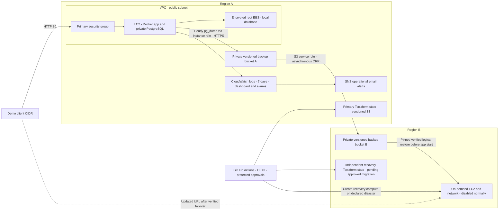

# Architecture and provider choice

CyberShield demonstrates a complete AWS region failure using a minimal Flask
page and self-managed PostgreSQL containers. It is a university demonstration,
not a highly available production learning platform. The app stays minimal;
backup and orchestration code belongs to infrastructure operations.

Normal operation retains only the regional data layer in B. Supporting global IAM roles/profiles are prepared in bootstrap before an incident, not created during failover. During failover, the pipeline
uses the same Terraform root with Region B inputs, independently accessible
state and a pinned replicated manifest. It provisions compute, restores data,
checks database/HTTP health and a known record, then publishes the recovery URL.
DNS automation is optional and is not required; the runbook explicitly changes
the demo URL. During failback the recovery writer is fenced before its final
dump; A restores that dump and is verified before B compute is removed.

## Components and alternatives

| Generic capability | AWS choice | Equivalent example | Reason |
|---|---|---|---|
| Virtual network/firewall | VPC, subnet, SG | GCP VPC/firewall or Azure VNet/NSG | Explicit network boundaries without NAT or load balancer cost |
| VM with containers | EC2 with encrypted EBS | Compute Engine or Azure VM | Direct fit for the assignment's minimal PostgreSQL VM |
| Object backups/replication | S3 with CRR | Cloud Storage transfer or Azure Blob replication | Keep recovery data without running a second database |
| Identity | IAM roles, STS/OIDC | Service accounts or managed identities | Temporary credentials, workload/deployment identities separated |
| Monitoring/notifications | CloudWatch and SNS | Cloud Monitoring or Azure Monitor | Logs, dashboard and alarms using native services |
| Budget | AWS Budgets | Cloud Billing or Cost Management | Verified USD 10 alerts at 50/80/100 percent |

The team chose AWS because its existing account, CLI experience and Terraform
modules already cover this architecture; switching providers would not improve
the demonstration objective. Academic credit/free-tier availability must be
verified against the actual account rather than assumed. Terraform code is not
portable between cloud providers: capability boundaries are the reusable design.

## Boundaries and tradeoffs

No public PostgreSQL port or SSH ingress. HTTPS egress is necessary to bootstrap
from AWS/GitHub/registries. Public HTTP is limited to demo CIDRs and non-sensitive
sample data. S3/state are private and encrypted; state is not stored with dumps.
The VM is a single point of failure by design. Recovery depends on backup age,
replication lag, independent state, GitHub/OIDC, available AMIs, external package
registries and reviewer response. The script checks archives rather than copying
live data files. A checksum alone is not authenticity protection.

The existing root volume is deleted with EC2. Cold replacement therefore needs
a verified restore manifest. Pilot light reduces standby cost but increases RTO;
active-active, Kubernetes, managed databases, NAT and ALB are unnecessary extras.
Production TLS/authentication, automated DNS and PITR would need a separate
business decision. Current implementation and deployment status is tracked in
`../status.md`; do not equate declared recovery code with a completed DR test.
